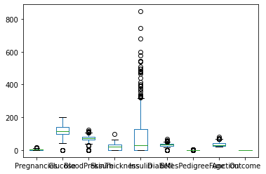
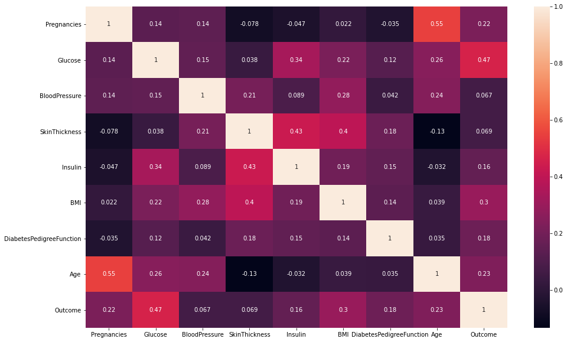
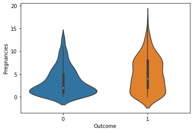

*LIS 4761/5765 Data Mining and Analytics, M.S. Information Technology, Florida State University — Fall 2021*
*Notebook: [view on GitHub](https://github.com/AJMFSU/AJMFSU/blob/main/LIS4761_5765_Data_Exploration_Amy_McMullin.ipynb) · [open in Colab](https://colab.research.google.com/github/AJMFSU/AJMFSU/blob/main/LIS4761_5765_Data_Exploration_Amy_McMullin.ipynb) · [download a copy](/files/LIS4761_5765_Data_Exploration_Amy_McMullin.ipynb)*

## The assignment

This was an early assignment, before the course moved on to machine learning. Take a real dataset and explore it before modeling anything: look at its shape, find the problems in it, clean what needs cleaning, and use charts to find the relationships worth investigating. I worked in a Google Colab notebook with pandas, matplotlib and seaborn.

The data is the Pima Indians Diabetes dataset, originally from the National Institute of Diabetes and Digestive and Kidney Diseases: 768 patient records with eight measurements each (pregnancies, glucose, blood pressure, skin thickness, insulin, BMI, a diabetes pedigree score and age) and an outcome column recording whether the patient was diagnosed with diabetes.

## What the notebook does

1. **Looks for outliers.** A box plot of every column at once showed insulin values running past 800 and skin-thickness readings near 100.

   

2. **Cleans.** Removed records with skin thickness over 80 mm or insulin over 600, which left 764 of 768 records, and replaced zero insulin readings with the median.
3. **Profiles age.** A histogram, a density plot and summary statistics: ages run from 21 to 81, with a median of 29 and a long tail toward older patients.
4. **Correlates.** A Pearson correlation heatmap across all nine columns.

   

5. **Compares groups.** A violin plot of pregnancies by outcome, plus a scatter plot and a full pair plot colored by outcome.

   

## What it showed

- **Glucose has the strongest relationship with a diabetes diagnosis** (r = 0.47), followed by BMI (0.30), age (0.23) and number of pregnancies (0.22).
- **Age and pregnancies are correlated with each other** (0.55), so part of what looks like a pregnancy effect is probably an age effect.
- **Skin thickness and insulin move together** (0.43), and both are related to BMI.

## Looking back

The cleaning step only treated zeros in the insulin column. The box plot also shows zeros for glucose, blood pressure, skin thickness and BMI, which are impossible values for a living patient and are really missing data. Leaving them in pulls those correlations toward zero. Today I would treat every impossible zero as missing before calculating anything, and record how many values each fix touched.

That habit — checking whether a value is possible before trusting it — is one I now teach directly, because it applies to network logs and sensor readings as much as to health data.

*This write-up was drafted with AI assistance from the notebook and its outputs. The notebook, the analysis and the charts are mine, from Fall 2021.*
