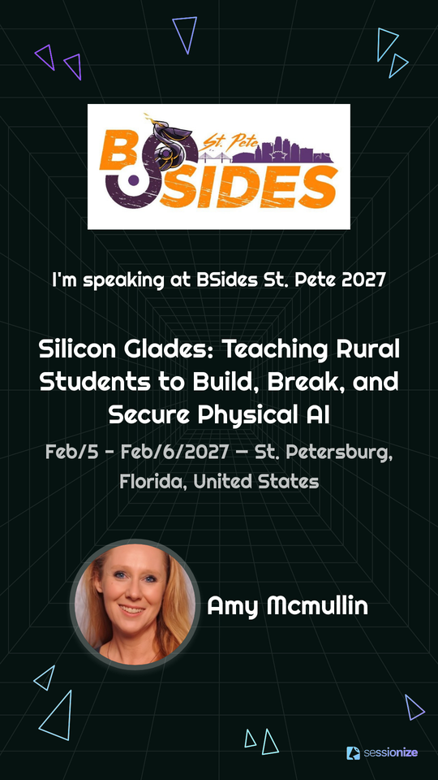

*BSides St. Pete 2027 · Saturday, February 6, 2027 · SPC Midtown Campus, St. Petersburg, Florida · 45-minute talk, session time to be announced*

## Abstract

Every trade is getting a robot, a camera or an AI model, and every one of those devices becomes an endpoint someone has to secure. Silicon Glades is a grassroots initiative at Immokalee Technical College (iTECH), in a rural farmworker community on the edge of the Everglades. It brings edge AI and robotics into the classroom one small grant at a time, built around a simple model: other programs use the devices, and IT and cybersecurity students onboard, harden and defend them.

This talk shows what that looks like in practice. The AI Innovation Lab runs on rotating stations: robotic arms, a machine-vision robotics kit, single-board Linux computers, voice AI assistants and an industrial logistics trainer. Students treat each device as an IoT endpoint to inventory, network, harden and document. They red-team LLM assistants for prompt injection and work tiered SOC-analyst shifts. The lab even kept a cloud-dependent consumer robot running on a self-hosted server after its vendor went dark.

You'll also hear the part nobody puts on a slide: how a teacher funds a lab like this with $200 crowdfunding asks and cross-program grant proposals, and what breaks along the way. The session closes with ways practitioners can help, including mentoring, guest labs, donated hardware, and entry-level job postings that don't screen out the defenders the industry says it can't find.

## Background

The talk draws on work described elsewhere on this site:

- [iTECH AI Innovation Lab](/portfolio/ai-innovation-lab/): the rotating-station lab and the Silicon Glades grants that fund it
- [Shift Change at the SOC](/portfolio/soc-simulation/): the tiered SOC-analyst simulation
- [Industrial Networking Labs](/portfolio/skill-boss-logistics-labs/): the logistics trainer labs

*The abstract was drafted with AI assistance from my notes and project history. The work it describes, and the talk itself, are mine.*

[BSides St. Pete](https://bsidesstpete.com/)
